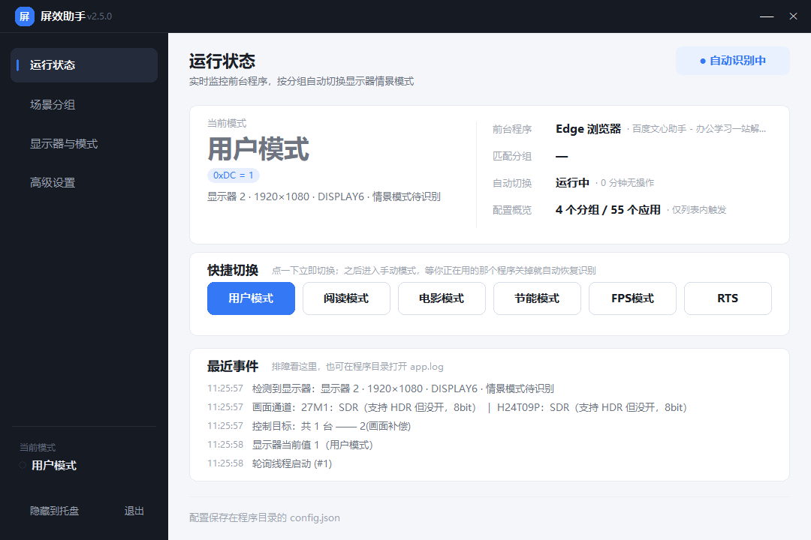
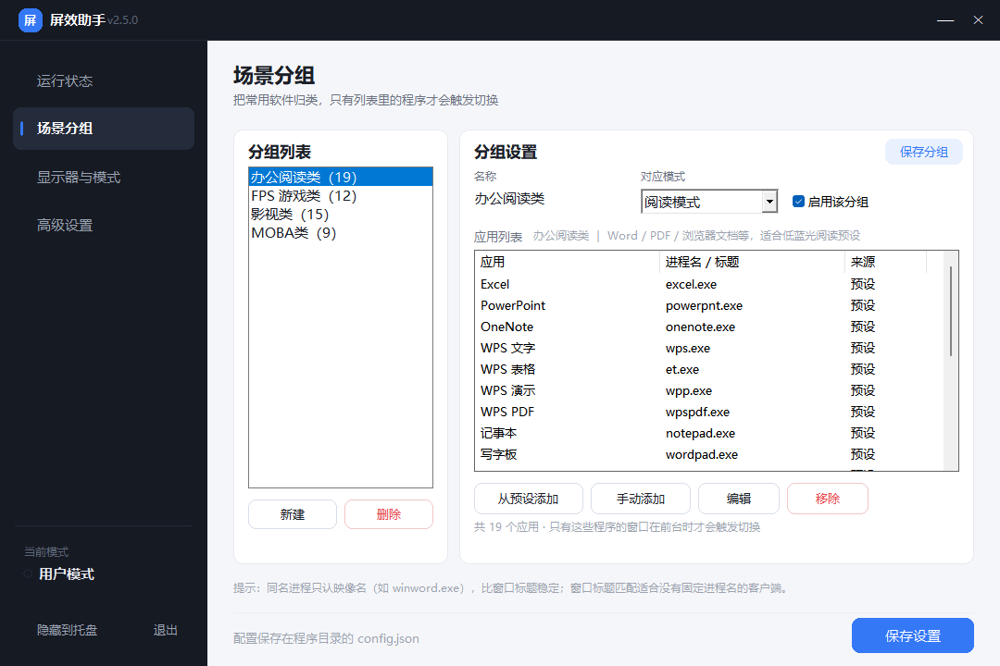
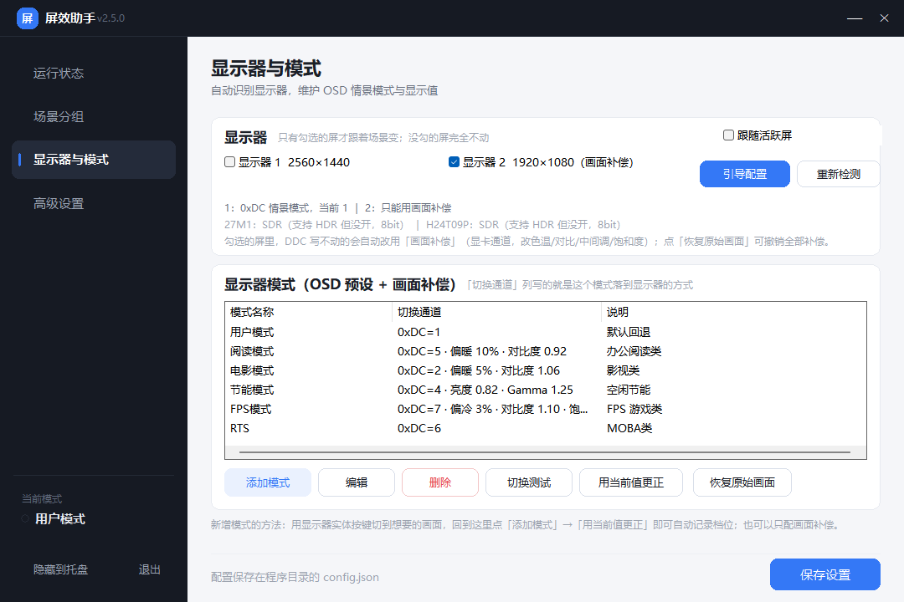
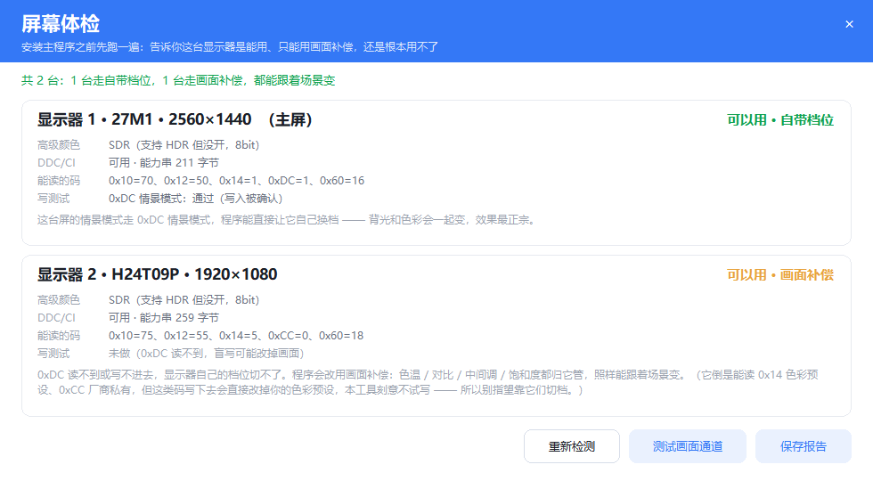
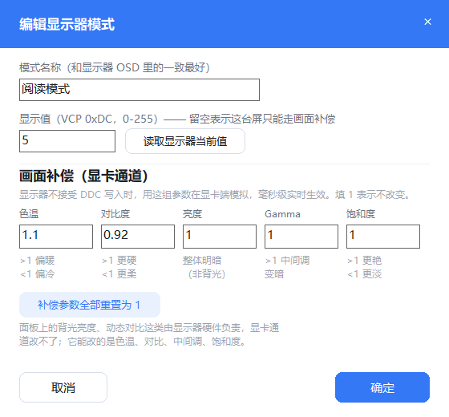
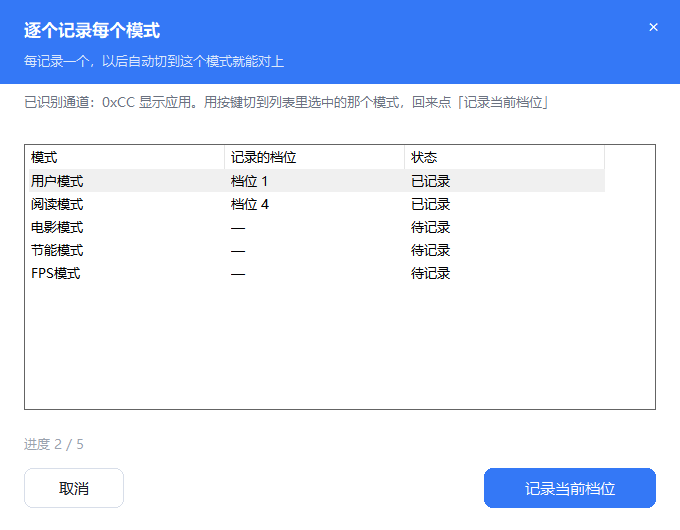

# 屏效助手 · ScreenMode

> 按你正在用的软件，自动切换外接显示器自带的 OSD 情景预设（阅读 / 电影 / 节能 / FPS…），
> 不需要厂商软件，也不用记快捷键。

Windows 上很多外接显示器有好几套"情景模式"（阅读、电影、FPS、节能），
但切换只能靠按显示器背后的实体按键——每天几十次，很烦。
这个小工具帮你自动切换，**两条通道一起上**：

- **DDC/CI 真值**（VCP `0xDC`）—— 让显示器自己换 OSD 预设，连背光都跟着变，最正宗
- **画面补偿**（显卡 Gamma Ramp）—— 改显卡查找表，**不依赖显示器固件、不依赖 DDC、不看品牌**，任何屏都能用

每台屏单独判断走哪条：写得进就用真值，写不进就自动降级用补偿。所以**就算你的显示器根本读不到情景模式，也照样能跟着场景变**。

- 打开 Word / 浏览器文档 → **阅读模式**
- 打开 PUBG / CS2 / CF → **FPS 模式**
- 打开腾讯视频 / 爱奇艺 / PotPlayer → **电影模式**
- 离开键盘 10 分钟 → **节能模式**，一有操作立刻恢复
- 其它没配置过的程序 → 不触发，乖乖回到你的默认模式
- 打开屏效助手自己的界面 → 什么都不做，保持当前模式

> **只想用，不想折腾源码？** 去 [Releases](https://github.com/duoemma/ScreenMode/releases)
> 下 `屏效助手.exe`，双击就能跑 —— 不用装 Python，不用装任何运行库。
> 想先确认自己这块屏行不行，再下 `屏幕体检.exe`（独立小工具，可选）。



> **遇到问题 / 想提需求**：去 [Issues](https://github.com/duoemma/ScreenMode/issues) 说一声。
> 最有用的是贴程序目录下的 `app.log` —— 它只记前台进程名、切换结果和错误，
> **不记录窗口里的内容**，可以直接发。

## 2.5.0 更新要点

这一版解决的是"**两块屏我都在用，勾死一块太僵**"：新增「跟随活跃屏」，
让程序自己判断你此刻在哪块屏上干活，把情景模式落到那块屏上。

- **跟随你正在用的那块屏** —— 以前只能"勾死"让哪几台跟着变。现在勾上
  「跟随活跃屏」，控制目标就变成**你此刻正在操作的那一块**：在哪块屏上开 Word，
  哪块屏进阅读模式。见[跟随你正在用的那块屏](#跟随你正在用的那块屏)。
- **旧屏保持上一次的样子** —— 控制权转移时**不撤**原来那块屏的补偿。
  你从副屏走回主屏，副屏还是刚才那个色调，不会"我一走它就弹回原样"。
- **3 秒滞回，鼠标划过去不算** —— 鼠标划到另一块屏取个东西就重切一次 DDC，
  画面会闪。所以候选屏要**连续稳定几秒**（默认 3 秒，可配 1~30）才真的转移，
  中途抖回来一次就重新计时。
- **判定依据：前台窗口优先，鼠标兜底** —— 用键盘写文档、打游戏时鼠标可能一直
  停在另一块屏上，只看鼠标会长期判错；而从桌面点图标又会把控制权甩回主屏。
  所以以前台窗口所在屏为准，只有前台是桌面/任务栏/开始菜单时才退回鼠标位置。
- **顺手修掉 exe 属性页的版本号** —— 之前它写死在 2.3.0，程序里已经是 2.4.0 了。
  现在直接从版本号生成，不会再停在旧值。

## 2.4.0 更新要点

这一版解决的是"**我只要副屏跟着变，主屏别乱动**"，顺便把安装程序整个去掉了。

- **只有勾选的屏才会跟着场景切换** —— 没勾的屏**完全不碰**：不写 DDC，
  也不套画面补偿。以前取消勾选是"半有效"的：DDC 那边确实不写了，
  但画面补偿那边还在按"所有屏"补，于是副屏切阅读模式，主屏明明没动也跟着变暖。
  现在两条通道都认这个勾选。
- **取消勾选会立刻把那台屏恢复原样** —— 它之前套着的补偿当场撤掉，
  不会定格在上一个模式的色调上。
- **去掉安装程序，纯绿色** —— 双击 `屏效助手.exe` 就能跑，
  配置 / 日志 / 补偿基线全在 exe 旁边那一层。不想要了就把文件夹整个删掉，
  没有卸载程序、不写注册表。开过开机自启的话，挪动或删除文件夹后自启项会自动
  跟着当前 exe 校正。

## 2.3.0 更新要点

这一版解决的是"**装之前不知道自己行不行、装完发现白折腾**"。

- **新增「屏幕体检」独立小程序**（`屏幕体检.exe`）—— 不用装主程序，双击就告诉你
  这台屏是能用自带档位、只能用画面补偿，还是根本用不了。全程只读；
  和主程序放在同一个文件夹里，换新屏之后随时复检。
  见[安装前先体检](#安装前先体检)。
- **不再把「自动管理颜色」误报成 HDR** —— 之前状态卡会写"HDR 已开启"，
  可 Windows 的「自动管理颜色」(ACM) 占用的是同一个状态位。现在改称
  **「高级颜色」**，并且**只在那块屏确实要靠画面补偿时才提醒**：
  走自带档位的屏提都不提，省得看着像程序在瞎报。
- **引导检测走不通时，直接给你最优解** —— 以前只给「改用亮度/对比度」
  （弱模拟，颜色一点不变）；现在第一个按钮就是「用画面补偿（推荐）」，
  点完什么都不用再配。
- **文案统一**：副屏统一叫「画面补偿」，不再出现"只能用亮度/对比度"这种
  让人以为只能调背光的说法。

## 2.2.0 更新要点

这次解决的是最顽固的一个问题：**有些显示器根本读不到「情景模式」，主页点了也毫无反应。**

- **新增第二条通道：画面补偿（Gamma Ramp）** —— 直接改显卡的 256×3 查找表，绕开显示器固件、绕开 DDC。**不看品牌、不看型号、不看 DDC/CI 能力串**，任何显卡、任何显示器都成立，毫秒级实时。见[两条通道的分工](#两条通道ddc-真值-vs-画面补偿)。
- **逐台自动降级** —— 一台屏一台屏地判断：DDC 写得进就用显示器自己的预设（最正宗）；写不进、或者干脆读不到情景模式，就自动改用画面补偿。**互不影响，一台失败不拖累另一台。**
- **写入后读回比对** —— 终于抓到了「假成功」：有的屏 `set_vcp_feature` 返回成功、`get_vcp_feature` 也照常返回数字，但读回的根本不是刚写进去的值（实测写 1 读回 4、写 4 读回 144）。API 层一点错都不报，只有比对才露馅。现在这类屏会被标成 **「写入被忽略」** 并自动切到补偿通道。
- **主页能看到结果了** —— 状态卡上多一行「1号 0xDC 情景模式 · 2号 补偿」，点完立刻知道每台屏到底走了哪条路、哪台没救回来，不用去翻日志。
- **高级颜色会拦住补偿** —— HDR 或 Windows 的「自动管理颜色」开启时，驱动接管查找表，写进去不报错但画面不变。程序检测到就提示「画面补偿被高级颜色挡住」，**不替你去关**（那是你为游戏/影片主动开的）。
- **模式对话框多了 5 个参数** —— 色温 / 对比度 / 亮度 / Gamma / 饱和度，都是 1.0 = 不改变，可以只配补偿不配档位。
- **「恢复原始画面」按钮** —— 补偿效果关掉程序也会保留（切了电影模式就该一直是电影模式），所以留了一个显式的撤销入口。

> 2.1.x 的老配置升级后，程序会给内置的 5 个模式**自动补上默认补偿参数**，副屏立刻就能跟着变了，不用手动配。

### 2.1.0 更新要点

- **添加显示器引导** —— 新接一台屏时自动提示走引导：你手动切两档情景模式，程序对比读数，**自动找出这台屏把情景模式挂在哪个 VCP 码上**（有的屏压根不报标准 `0xDC`）。全程只读，不改你任何设置。见[详细说明](#添加显示器引导自动找出情景模式挂在哪个码上)。
- **多显示器一起控** —— 原来是"只能选一台"，现在**接几台就控几台**，勾选立即生效，切换时同时写。
- **副屏不支持的自动兜底** —— 副屏没有「情景模式」这一项时，改用**亮度 + 对比度**模拟，每台走各自的通道，一台失败不影响其它台。
- **探测阶段只读不写** —— 启动时不对任何显示器做试写，不会打乱色彩预设。
- **`0x14` 色彩预设默认完全不碰** —— 实测写 8 读回 5、写 1 读回 4，写入不可靠，除非在 config 里显式指定。
- 修掉显示器页布局越界（内容压到底部保存条上）和日志里「不可控 / 0xdc」的措辞问题。

## 界面

四个页面，左侧栏切换：

四个页面在左侧栏切换：**运行状态**（当前模式、命中哪个分组、最近事件）、
**场景分组**（左分组右应用，内置 57 个常用软件）、**显示器与模式**（每台屏一条勾选
+ 引导配置，下面是「模式 ↔ 通道」那张表）、**高级设置**（确认方式、空闲节能、
默认回退、开机自启）。

| 场景分组 | 显示器与模式 |
| --- | --- |
|  |  |

| 切换确认弹窗 | 屏幕体检 |
| --- | --- |
|  |  |

| 编辑模式（档位 + 补偿并存） | 添加模式（两条都可留空） |
| --- | --- |
|  |  |

| 添加显示器引导 · 切模式 | 添加显示器引导 · 记录档位 |
| --- | --- |
|  |  |

## 功能

| 分类 | 说明 |
| --- | --- |
| **情景分组** | 应用按「办公阅读类 / FPS 游戏类 / 影视类 / 其它」分组，每组绑定一个显示器模式。**只有分组里的程序才会触发切换**。 |
| **预设库** | 内置 57 个常用软件（Word、WPS、Acrobat、PUBG、CS2、CF、无畏契约、腾讯视频、爱奇艺、优酷、B站…），勾选即加。 |
| **自定义应用** | 手动填「显示名 + 进程名」，或直接从**正在运行的程序**里挑；也支持按窗口标题关键字匹配。 |
| **自动识别显示器** | 枚举所有显示输出（分辨率 / 主屏 / 设备名 / 算不算 DDC 通），**接几台就控几台**；可以在界面上勾选只控制其中某几台。 |
| **多显示器一起切** | 切换时对**所有勾选的显示器同时处理**，不是只动主屏。每台走自己识别出来的通道（档位号 / 私有码 / 亮度对比度 / 画面补偿），一台失败不影响其它台。 |
| **跟随活跃屏** | 不想勾死某一块？打开「跟随活跃屏」，控制目标自动变成**你此刻正在操作的那块屏**（前台窗口为准，桌面/任务栏时退回鼠标位置）。3 秒滞回防抖，旧屏保持上一次的样子，不会你一走就弹回原样。 |
| **画面补偿（Gamma）** | **不依赖 DDC 的第二条通道**：直接改显卡查找表，任何显卡任何显示器都能用。5 个参数（色温/对比/亮度/Gamma/饱和）毫米级实时生效，专门救那些读不到情景模式的屏。 |
| **写入后读回比对** | 写完 DDC 会读回来比一遍。有的屏 `set` 返回成功、`get` 也返回数字，但读到的不是刚写的值（实测写 1 读回 4）—— 这类屏会被标成「写入被忽略」并自动切到补偿通道，不再假装成功。 |
| **逐台自动降级** | 能写真值就用显示器自己的预设（最正宗），写不进就降级到画面补偿。判定按每台屏单独做，不会因为一台卡住就全都不动。 |
| **自动识别通道（引导）** | 新接的屏第一次启动会主动引导：你手动切两档，程序对比读数自动找出「情景模式」挂在哪。找不到就退到亮度对比度 + 画面补偿兜底，并告诉你可能的原因。 |
| **模式管理** | 自由增删改「模式 ↔ 切换通道」，一键**用当前值更正**——用显示器按键切到想要的效果，回来点一下就把数字记下来了（多台显示器一起记）。每个模式可以同时配「档位」和「画面补偿」，主屏走档位、副屏走补偿，一次切换两台一起变。 |
| **恢复原始画面** | 一键撤销所有画面补偿，回到显卡原本的输出曲线（原始曲线存在 `gamma_base.json` 里，恢复的是真采样到的那份，不是简单的恒等斜坡）。 |
| **切换确认弹窗** | 检测到情景时弹窗让你确认（可倒计时自动切换），也可以关掉，改成静默切换。**选完就在后台直接切，不会把主界面顶出来**。 |
| **每个分组只问一次** | 确认过的选择会被记住：之后离开再回来（比如打完一局退出游戏、又开一局）**直接静默切回去，不再弹窗**；改过配置或手动切过才会重新问。 |
| **多进程游戏也认得住** | 同一款软件的多个进程（`TslGame.exe` / `TslGame_BE.exe` / `Xxx-Win64-Shipping.exe`）按「应用族」合并，还会顺着父进程链找 —— 游戏换进程、加启动器都不会被当成"新程序"重新问一遍。 |
| **全屏游戏不跟着抖** | 全屏游戏运行时，前台窗口会周期性跳到别的进程上（加载画面、Steam 覆盖层、系统弹窗）。程序会认出这是「全屏程序还在跑」，**给 90 秒宽限、期间一次都不切**——避免显示器反复换档导致的掉帧。 |
| **不拖累游戏帧数** | 读显示器当前值的 DDC/CI 调用走 I2C 总线、单次约 60ms 且会占住显示栈，所以只在**每 15 秒**检查一次（原来每 1.5 秒一次）。实测 90 秒内阻塞从 3.7 秒降到 0.4 秒。 |
| **看视频不会被当成空闲** | 看片时人不会碰键鼠，`GetLastInputInfo` 会一路涨到 10 分钟把屏幕切成节能模式。程序会读**默认播放设备的音量峰值**（Core Audio），最近 90 秒内有声音、或前台是全屏窗口，就**不算空闲**。浏览器 / 本地播放器 / 音乐软件通用。 |
| **自动识别模式** | 界面右上角一个按钮：点一下立刻回到自动识别。手动切换后进入「手动模式」，**等你正在用的那个程序关掉，自动识别会自己同步开启**，下次打开别的软件无缝接上。 |
| **托盘常驻** | 系统托盘图标颜色跟着当前模式变，右键可快速切换模式、切回自动识别、暂停自动切换、开机自启。 |
| **不管自己** | 打开/切到屏效助手自己的窗口时不算"前台应用"，**保持刚刚检测到的模式**，不会莫名跳回默认模式。 |
| **尊重手动操作** | 你用显示器按键自己改了模式，程序察觉后会暂停自动切换 10 分钟，不跟你抢。 |
| **开机自启 + 单实例** | 写注册表 Run 项，不会开出第二个窗口。 |

## DDC / CI 是什么

这两个缩写经常一起出现，其实是两层东西：

| 缩写 | 全名 | 是什么 |
| --- | --- | --- |
| **DDC** | Display Data Channel，显示数据通道 | 显卡和显示器之间**那条数据线**。物理上复用 HDMI / DP / VGA 里的 I²C 总线（两根线：时钟 + 数据），显示器把能力清单写在自己的 **EDID** 里，显卡开机时读出来就知道这台屏支持多少分辨率、什么时序。 |
| **CI** | Command Interface，命令接口 | 跑在 DDC 通道上的**那套命令**。它的正式标准叫 **MCCS**（Monitor Control Command Set），定义了一堆"控件编号"（叫 **VCP 码**，Virtual Control Panel），每个编号对应显示器菜单里的一项。 |

所以 DDC 是"路"，CI 是"路上说的话"。合起来 DDC/CI 就是：**电脑不用按显示器上的实体按键，也能直接读写显示器菜单里的设置**。

程序实际干的事情很简单：往某个 VCP 码里写一个数字。

| VCP 码 | 对应菜单项 | 说明 |
| --- | --- | --- |
| **`0xDC`** | 情景模式 / 显示模式选择（Display Mode Select） | **本程序的主通道**。厂家把"阅读 / 电影 / FPS / 节能"这些预设映射成 0…N 的档位号，写几就等于按了几下实体键切到第几档。 |
| `0x10` | 亮度 | 几乎所有屏都支持，最可靠的通道 |
| `0x12` | 对比度 | 同上 |
| `0x14` | 色彩预设 | 很多屏有，但**写入行为不可靠**（见下） |
| `0x60` | 输入源（HDMI / DP 切换） | 不在本程序用途内 |
| `0x87` | 锐度 | 部分屏支持 |

六个容易踩的坑：

1. **不是所有屏都在能力串里报 `0xDC`。** 很多屏（尤其是用 Realtek 之类桥接芯片的）菜单里明明有「标准 / 用户 / 电影 / 图片 / RTS / FPS1 / FPS2」七档，但 MCCS 能力串里压根没有 `0xDC`。本机副屏 **H24T09P** 就是这样：能力串上报了 28 个码（比主屏的 24 个还多），唯独没有 `0xDC`。**这种情况只能靠「添加显示器引导」自动找出来**，或者干脆走画面补偿。
2. **`0x14` 色彩预设不能当"档位开关"用。** 实测某副屏写 8 读回 5、写 1 读回 4 —— 它不是"写不进去"，而是把你的值悄悄改成别的，等于打乱了你的画面。所以程序**默认完全不碰 `0x14`**。
3. **截图验证不了 DDC。** 屏幕截图抓的是显卡帧缓冲，而亮度 / 情景模式是显示器硬件后处理，截图里根本看不见。实测把亮度从 30 写到 100，画面平均亮度一模一样（233.46）。所以唯一可靠的验证方式是「人手动切、程序读值」。
4. **写完立刻读会失败。** 实测 `set_vcp_feature` 之后紧接着 `get_vcp_feature` 会抛「DDC/CI 消息的命令字段中的值无效」—— 那不是写入失败，只是显示器还没处理完上一条命令。程序会先等 0.22 秒（`VERIFY_SETTLE`）再读，读失败还会重试几次。**这条坑差点让我们把主屏误判成"写不进去"**。
5. **API 说成功不等于真的成功。** 有的屏写入被静默丢弃：`set` 返回成功、`get` 也照常返回数字，但读到的其实是显示器自己原来的值。**必须读回比对**才发现。这就是 2.2.0 加「写入后读回」的原因。
6. **DDC 读很慢。** 一次读写约 60ms（首次 175ms），期间占着显示栈。所以程序把"读当前值"从每 1.5 秒降到每 15 秒一次，切档只在真的需要时写。

## 两条通道：DDC 真值 vs 画面补偿

程序有两条**完全独立**的通道，按每台屏的实际情况自动挑，不会叠加：

| | **DDC 真值** | **画面补偿（Gamma Ramp）** |
| --- | --- | --- |
| 原理 | 往显示器的 VCP 码写数字，让**显示器自己**换 OSD 预设 | 改**显卡**的 256×3 查找表，像素值在出门前就被改掉 |
| 依赖 | 显示器固件实现该 VCP 码 + 驱动放行 I²C + 显示器肯接受写入 | **什么都不依赖**。不看品牌、不看型号、不看 DDC |
| 能改什么 | 整档情景模式，连背光亮度、动态对比、锐度都跟着变 | 色温、对比度、亮度（像素级）、中间调 Gamma、饱和度 |
| 改不了什么 | —— | **改不了背光亮度**（那是面板硬件），也改不了锐度/降噪/动态对比 |
| 生效速度 | 60~300ms，取决于显示器固件 | 毫秒级 |
| 高级颜色开启时 | 正常（HDR 下写 `0xDC` 依然有效） | **失效** —— 驱动接管查找表，写进去返回成功但画面不变 |
| 适用 | 大多数正规显示器 | 所有显示器，**尤其是读不到情景模式的那种** |

判定顺序（每台屏单独算）：

1. 写显示器**自己的模式预设**（`0xDC` 或引导识别出的私有码）→ 读回一致 → **完成，不再补补偿**
2. 只写了**亮度/对比度** → 读回一致 → 再补一层画面补偿（亮度对比度只动硬件，颜色一点没变，光靠它模拟不出暖色阅读模式）
3. 写进去了但**读回对不上**（被静默丢弃）→ 改用画面补偿
4. **DDC 完全不通** → 改用画面补偿
5. 没有补偿参数、或这块屏 **处在高级颜色模式** → 这台宣告「无通道」

### 画面补偿的 5 个参数

在「显示器与模式」→ 添加/编辑模式里填，**1 表示不改变**：

| 参数 | 范围 | 作用 |
| --- | --- | --- |
| **色温** | 0.60 ~ 1.50 | >1 偏暖（提红压蓝），<1 偏冷。1.10 ≈ 加 10% 暖 |
| **对比度** | 0.50 ~ 1.60 | 绕中灰缩放。>1 更硬，<1 更柔 |
| **亮度** | 0.30 ~ 1.60 | 整体增益。**注意是像素级，不是背光** |
| **Gamma** | 0.50 ~ 2.50 | >1 中间调变暗（更有层次），<1 变亮 |
| **饱和度** | 0.00 ~ 1.80 | >1 更艳（游戏模式常用），0 = 全灰 |

内置的 5 个模式已经带好了默认值：阅读（偏暖 10% + 对比 0.92）、电影（偏暖 5% + 对比 1.06）、节能（亮度 0.82 + Gamma 1.25）、FPS（偏冷 3% + 对比 1.10 + 饱和 1.15）。

想撤销全部补偿：**显示器与模式** → 右下角 **恢复原始画面**。

> 补偿效果**关掉程序也会保留** —— 切到电影模式后关程序，画面应该还是电影模式，而不是"一关就变回去"。所以要靠上面的按钮显式撤销。
> 补偿前后的原始曲线会存在程序目录的 `gamma_base.json` 里。**恒等斜坡 ≠ 原始值**：驱动自己的色彩校正、Windows 的「颜色校准」都改过这张表（本机主屏原始中间调 30840，恒等是 32896），所以程序记的是真正采样到的那份，恢复才准。

## 为什么有些显示器读不到情景模式（和品牌/年份有关吗）

**基本无关。** MCCS 里 `0x10` 亮度 / `0x12` 对比度是基础项，2005 年之后的液晶几乎都有；但 `0xDC`（Display Mode Select）是**厂家可选实现**的码 —— 它要和整张 OSD 模式表一一对应，实现成本比 `0x14` 色彩预设高得多，很多固件索性不报。

本机两块屏就是现成的反例：

| | 27M1（主屏） | H24T09P（副屏） |
| --- | --- | --- |
| 生产周期 | 2025 年第 14 周 | 2022 年第 45 周 |
| 品牌 | SKG（同厂） | SKG（同厂） |
| 能力串上报的码 | 24 个 | **28 个（更多）** |
| 有没有 `0xDC` | **有** | **没有** |

同品牌、**更老的那块反而上报的码更多**，只是唯独缺了 `0xDC`。

按设备类型看比按年份看准得多：

| 设备类型 | DDC/CI | `0xDC` 情景模式 |
| --- | --- | --- |
| 笔记本内屏（eDP 直连） | **物理上没有** | 无从谈起 |
| 便携屏 / 走 Realtek·ITE 桥接芯片 | 通常只有亮度 | 基本没有 |
| 电视当显示器（HDMI） | 有 | 少见，通常只有 `0x60` 输入源 |
| 入门 / 电商白牌显示器 | 亮度、对比度 | 常缺 |
| 主流品牌常规型号 | 较完整 | 部分有 |
| 带 FPS / RTS 预设的游戏显示器 | 较完整 | 相对更可能有，常只在 DP 下暴露 |
| 专业 / 色彩管理向（Eizo、NEC、高端 Dell、商用 Philips） | 最完整 | 多数有 |

除了固件没实现，另外两个常见原因：

- 显示器 OSD 里的 **DDC/CI 开关是关着的**（有的叫「显示器控制」），关了就是彻底读不到
- 中间隔了**扩展坞 / KVM**，把 I²C 信号挡掉了

好在 2.2.0 起这几种情况都不再是死路：**画面补偿不依赖 DDC**，照样能让每台屏跟着场景变。

## 添加显示器引导（自动找出「情景模式」挂在哪个码上）

第一次接上一台新显示器时，程序会主动问你要不要走一遍引导；随时也可以点「显示器与模式」页右上角的 **引导配置**。

向导一共两步 + 一次逐模式记录：

| 步骤 | 你要做的 | 程序在干什么 |
| --- | --- | --- |
| ① 切到模式 A | 用显示器按键把情景模式切到【标准】（或任何一档），点「已切好，读取」 | 读出这台屏**能力串里上报的每一个 VCP 码**的当前值 |
| ② 切到模式 B | 再切到**另一个**档位（比如【电影】），点「已切好，读取」 | 对比两次读数，**哪个码变了，哪个就是情景模式通道** |
| ③ 逐模式记录 | 对每个模式：按键切过去 → 点「记录当前档位」 | 把这台屏在该模式下的档位号记进配置 |
| ④ 完成 | 点「完成」 | 写入 config，之后切换会自动带上这台屏 |

为什么必须你手动切：每台屏用的码不一样，且**没有任何软件手段能替你按显示器的实体键**。整个过程**只读不写**，不会改你任何设置。

如果两次切完所有码都没变，向导会直接给你两个选择：**「用画面补偿（推荐）」** —— 点一下就好，什么都不用再配；或者「改用亮度/对比度」这个更弱的老办法。常见的三个原因：

- 显示器菜单里 DDC/CI 是关着的（有的叫「显示器控制」）
- 这台的模式切换压根不走 DDC，只能用实体按键
- 中间隔了扩展坞 / KVM，把 DDC 信号挡掉了

**引导不是必选项。** 2.2.0 起，读不到情景模式的屏可以直接靠画面补偿工作 —— 在「显示器与模式」里给模式填上补偿参数就行，跳过引导也完全能用。

## 安装前先体检

不想装完才发现"我这块屏怎么配都不动"？先跑 **`屏幕体检.exe`** ——
它和主程序完全独立，不用安装、不读主程序的配置，双击就能用。


它逐台告诉你四件事：

| 查什么 | 怎么查 | 结果怎么看 |
| --- | --- | --- |
| 高级颜色 | `QueryDisplayConfig` 读 HDR / 广色域 / 色深 | 高级颜色开着，画面补偿会被系统接管 |
| DDC/CI | 打开显示器通道，读 MCCS 能力串 | 不通就只剩画面补偿这条路 |
| 哪些码能读 | 逐码读 0x10 / 0x12 / 0x14 / 0xDC / 0xCC / 0x60 | 读得出来不等于写得进去 |
| 0xDC 写不写得进 | **把当前值原样写回去**，再读回比对 | 写回同值 = 空操作，画面不会变 |

结论只有三档：**可以用（自带档位）** / **可以用（画面补偿）** / **用不了**。

点「测试画面通道」会让屏上真的偏暖变亮一下，然后问你一句**「看到了吗」** ——
这一步必须由你的眼睛裁决：gamma 改的是显示器收到的查找表，**截图抓不到任何变化**，
程序永远没法自证"生效了"。10 秒不选会自动恢复原样。

「保存报告」会在桌面生成一份 `屏幕体检报告-<时间>.png/.txt`，出问题直接把图发出去就行。

> 体检**只读**。唯一的写操作是"把 0xDC 的当前值写回去"，等于什么都没改。
> 对 0x14 / 0xCC 这类码**连试都不试** —— 实测写它们会真的改掉显示器的色彩预设
> （写"读到的 5"进去，画面从 6500K 跳到 9300K），这个坑已经写进代码注释了。

体检和主程序放在同一个文件夹里。换了个新屏、或者某台突然不跟着变了，
随时双击复检，不用重新下载。

### 只让一块屏跟着变

主桌面在干活，只有旁边的副屏想跟着场景换色调？把**主屏的勾去掉**就行。

勾选是**两条通道一起认**的：没勾的屏不写 DDC，也不套画面补偿 —— 它保持
你上次手动设的样子，一根手指头都不碰。取消勾选的那一刻，那台屏上残留的
补偿会被立刻撤掉，不会定格在上一个模式的色调上。

> 一台都不勾 = 全部控制（不是"都不控"）。这是为了别让配置坏掉时程序静默不干活。

### 跟随你正在用的那块屏

勾选是"死"的：勾了就一直控，不勾就一直不控。可很多时候两块屏都在用 ——
上午在副屏写文档，下午回主屏打游戏，每次都去手动改勾选太麻烦。

勾上「显示器与模式」卡片右上角的**跟随活跃屏**，控制目标就变成
**你此刻正在操作的那一块**：

- 在哪块屏上开 Word，哪块屏进阅读模式
- 换到另一块屏干活，控制目标 3 秒后跟过去，当前模式一并补上
- **原来那块屏保持上一次的样子**，不撤销、不恢复、不闪

判定规则（按可靠程度排）：

| 情形 | 依据 |
| --- | --- |
| 前台是个正常程序（Word、游戏、浏览器…） | 按**前台窗口**落在哪块屏 |
| 前台是桌面 / 任务栏 / 开始菜单 / Alt+Tab 界面 | 退回**鼠标位置** |
| 刚插上还没重新检测的陌生屏 | 不动，等程序认出来 |

为什么不是"只看鼠标"：用键盘写文档、打游戏时鼠标可以几十分钟不动，
只看鼠标会长期判错。为什么也不是"只看窗口"：从桌面双击一个图标，
前台会短暂变成桌面，控制权就被甩回主屏了。

为什么不立刻跟：鼠标划到另一块屏取个东西，立刻转移就要重切一次 DDC
（部分屏切档位时画面会黑一下）。所以候选屏得**连续稳定 3 秒**才算数 ——
这个秒数在 `config.json` 的 `monitors.follow_stable_seconds` 里，允许 1~30。

跟随模式下勾选框会置灰（勾选不再决定控谁，只作为"允许被控的候选范围"），
但勾选状态会跟着活跃屏跳动，一眼能看出当前跟的是哪台。状态卡上写的是
`显示器 2 · H24T09P · 跟随中（前台窗口）`。

### 多台显示器怎么协同

程序会枚举**所有**显示输出，最多 4 个勾选框。切换时处理所有勾选的屏，每台走自己识别出来的通道：

| 这台屏的情况 | 走哪条通道 | 存在配置里的位置 |
| --- | --- | --- |
| 支持 `0xDC` | 写档位号 | `modes[].vcp` |
| 挂在引导识别出的私有码上 | 写**那台屏自己的**档位号 | `modes[].monitor_vcp` |
| 只能调亮度对比度 | 写亮度 + 对比度，**再加一层画面补偿** | `modes[].per_monitor` |
| DDC 写不动 / 不通 | 只用画面补偿 | `modes[].gamma` |

几条约定：

- **纯只读探测**：启动时不对任何显示器试写。试写会把画面色彩预设改乱（真机踩过）。
- **一台失败不影响其它台**，状态卡和日志都会写清哪台走了哪条路。
- **没勾的屏完全不碰** —— DDC 和补偿都跳过。
- 配置里的 `monitors.vcp`（如 `{"1": 204}`）是引导识别出来的结果，**不要手改**。

## 运行环境

- Windows 10 / 11（x64）
- **不再强制要求 DDC/CI** —— 2.2.0 起没有 DDC 的屏也能用画面补偿跟着变
- 想要"真·换 OSD 预设"（连背光都变）才需要：显示器支持 DDC/CI + 菜单里的 **DDC/CI 已打开**（有的叫"DDC/CI"或"显示器控制"）
- 画面补偿只在 **SDR** 下有效；处在高级颜色（HDR / 自动管理颜色）的屏只能靠 DDC 通道

## 直接用

**绿色程序：双击 `屏效助手.exe` 就运行，没有安装步骤。**

从 [Releases](https://github.com/duoemma/ScreenMode/releases) 下载 `屏效助手.exe`
（或者从[源码自己打包](#打包)）。两个 exe 分别是什么：

| 文件 | 干什么 | 要不要下 |
| --- | --- | --- |
| `屏效助手.exe` | 主程序，托盘常驻、自动切模式 | **要**（约 16 MB） |
| `屏幕体检.exe` | 装之前先查这台屏行不行，只读不改 | 可选（约 15 MB） |

> **第一次打开会被 Windows 拦一下**：弹出"Windows 已保护你的电脑"是因为这个 exe
> 没有买代码签名证书（个人项目常见）。点 **更多信息 → 仍要运行** 即可。
> 杀毒软件可能也会报"未知程序"，加个信任就行 —— 想核实的话源码全在这个仓库里，
> 或者直接 `python main.py` 自己跑。

1. 双击 `屏效助手.exe`
2. 在「显示器与模式」里核对每个模式的**切换通道**：
   - 有 DDC 的屏：用显示器实体按键切到"阅读模式" → 回到程序 → 选中「阅读模式」→ 点 **用当前值更正**
   - 没有 DDC 的屏：直接给模式填画面补偿参数（色温/对比/Gamma/饱和）
3. 只想让某一块屏跟着变，就把其余屏的勾去掉（见[只让一块屏跟着变](#只让一块屏跟着变)）
4. 到「场景分组」里确认/增删每个分组的应用
5. 隐藏到托盘，正常用电脑即可

> 托盘图标如果在任务栏右下角看不到，点一下 `^` 展开隐藏图标，把它拖到常显区。

### 放在哪里、怎么删

程序会把所有运行期文件写在**自己旁边**：

| 文件 | 是什么 |
| --- | --- |
| `屏效助手.exe` / `屏幕体检.exe` | 程序本体 |
| `config.json` | 你的配置（分组、模式、勾选、补偿参数） |
| `app.log` | 运行日志 |
| `gamma_base.json` | 显卡原始查找表（撤销补偿时要写回去的基线） |
| `checkup_base.json` | 体检工具的画面基线 |

所以放**能写的目录**（桌面、D 盘随便建个文件夹、U 盘都行），
**别放 `C://Program Files`** —— 那里没有写权限，配置和日志会写不进去。

**想换个位置，整个文件夹一起挪**（自启项会自动跟着改）；
**不想用了，退出程序、把文件夹删掉就完事**。没有卸载程序，不散落文件。

> 唯一的例外是开机自启：它写在 `HKCU\...\Run` 里。删文件夹之后，
> 到 任务管理器 → 启动 里把「屏效助手」关掉即可。
> 想让程序彻底不碰注册表，就别开这个开关。

也可以把它放到 U 盘里，用环境变量指定数据目录：

```bat
set SCREENMODE_HOME=E:\ScreenModeData
屏效助手.exe
```

## 从源码运行

```bat
pip install -r requirements.txt
python main.py
```

调试时不想真的改显示器，用演练模式（只写日志）：

```bat
python main.py --dry-run
```

> 想重新画图标：`python _tools/make_icon.py`。图标缺失时 `build.py` 会自动跳过
> 图标参数、用默认图标出包，不会因为少一个文件就打包失败。

## 打包

```bat
python build.py                     :: dist\屏效助手.exe
python build.py --checkup           :: 只打「屏幕体检」dist\屏幕体检.exe
python build.py --all               :: 两个一起打
python _tools/make_zip.py           :: 桌面\屏效助手-源码-vX.Y.zip（不含运行时文件）
```

> `config.json` / `app.log` / `gamma_base.json` 都是**跑起来才有**的运行时文件，
> 不进源码包也不进 git：`gamma_base.json` 存的是你这台机器显卡的原始查找表，
> 拿到别的机器上会把人家的画面改歪。

## 目录结构

```
screenmode/
├── app.py          控制器：状态机、轮询线程、看门狗、托盘
├── config.py       config.json 读写 + 旧版本迁移
├── presets.py      内置应用预设库（加一行就能多一个基础选项）
├── matcher.py      前台进程 → 分组 的匹配
├── ddc.py          显示器枚举 + DDC/CI（VCP 0xDC）读写 + 写入后读回比对
├── apply.py        混合通道调度：DDC 真值 → 亮度对比度 → 画面补偿，逐台降级
├── gamma.py        Gamma Ramp 通道：显卡查找表读写、参数曲线、基线持久化
├── hdr.py          每台屏的高级颜色状态（HDR / 广色域 / 色深）
├── checkup.py      「屏幕体检」的探针逻辑（只读 + 0xDC 空写测试）
├── winapi.py       前台窗口 / 空闲时间 / 运行中程序 / 开机自启
└── ui/
    ├── base.py     Win32 封装：窗口、双缓冲绘制、自绘按钮、原生控件、模态框
    ├── theme.py    配色 / 字号 / 尺寸
    ├── mainwindow.py  主窗口 + 四个页面
    ├── checkupwin.py  「屏幕体检」窗口（含画面可见性自测）
    ├── wizard.py   添加显示器引导（7 步状态机）
    └── dialogs.py  切换确认、添加应用、预设选择、模式编辑、新建分组
checkup_main.py     「屏幕体检」入口（独立 exe，不依赖主程序配置）
build.py            打包脚本
assets/
├── icon.ico        图标（`_tools/make_icon.py` 生成）
└── app.manifest    DPI 感知 / 权限声明
docs/               使用说明 + 界面截图
_tools/             开发辅助：探针、真机验证、单元测试、截图脚本
```

`_tools/` 里的脚本是排查问题的家伙事，不是给日常用的 —— 比如
`probe_ramp.py` 看每块屏当前的 gamma 表、`probe_caps.py` 看 DDC 能力串、
`follow_e2e.py` 真机验证「跟随活跃屏」。反馈问题时跑一下把输出贴到 issue 里，比描述半天管用。

界面完全基于 `ctypes` 直接调 Win32 / GDI，**不依赖 tkinter**，可以在精简版 Python 上跑。

## 配置说明（config.json）

程序目录下的 `config.json`，改完重启即可（界面里改的话点「保存设置」）。

```jsonc
{
  "monitors": {
    "enabled": [0, 1],         // 要一起控制哪几台（序号从 0 起）；[] 或删掉 = 所有能控的都控
    "vcp": {},                 // 可选：强制某台改用别的 VCP 码，如 {"1": 20} 表示第 2 台用 0x14
    "setup_done": {"1": true}, // 走过引导的显示器（跳过引导的也算，避免每次启动都问）
    "follow_active": false,    // 跟随活跃屏：控「你此刻在用的那块」而不是固定勾选的
    "follow_stable_seconds": 3.0  // 候选屏要连续稳定几秒才转移（夹在 1~30）
  },
  "gamma": {"enabled": true, "warn_hdr": true},   // 画面补偿总开关 / 高级颜色提醒
  "poll_seconds": 1.5,         // 轮询间隔
  "debounce_seconds": 2.0,     // 前台程序切换后等多久才动作（防抖）
  "idle":       {"enabled": true, "minutes": 10, "mode": "节能模式",
                 "ignore_media": true, "ignore_fullscreen": true},
  "return_default": {"enabled": true, "mode": "用户模式"},
  "ask_before_switch": true,   // 切换前弹窗确认
  "dialog_timeout_seconds": 10,
  "manual_override_pause_minutes": 10,
  "override_check_seconds": 15,          // 多久查一次「显示器被手动改了」
  "leave_grace_seconds": 4,              // 前台离开分组后等几秒才回默认模式
  "leave_grace_fullscreen_seconds": 90,  // 全屏游戏还在跑时的宽限
  "modes": [
    {"name": "阅读模式", "vcp": 5, "color": "#3478F6",
     "gamma": {"warm": 1.10, "contrast": 0.92}},
    {"name": "电影模式", "vcp": 2,
     "per_monitor": {"1": {"brightness": 75, "contrast": 55}}},
    {"name": "自建护眼", "vcp": null,
     "gamma": {"warm": 1.15, "brightness": 0.90, "sat": 0.85}}
  ],
  "groups": [
    {"id": "office", "name": "办公阅读类", "mode": "阅读模式",
     "kind": "office", "enabled": true,
     "apps": [{"name": "Word", "exe": "winword.exe", "src": "preset"}]}
  ]
}
```

- `monitors.enabled` 是**要控制的显示器序号列表**。老配置里的 `monitor_index` 只用于兼容，不再限制控制台数。
- `modes[].vcp` 就是 VCP `0xDC` 的取值，**每台显示器不一样**，用界面里的「用当前值更正」记录最稳。
- `modes[].per_monitor` 是给**不支持 `0xDC` 的副屏**用的：记下它当前的亮度和对比度，切这个模式时一起写进去。
- `modes[].monitor_vcp` 是引导识别出来的「这台屏自己的档位号」，不同屏同一模式的档位号往往不同，所以按显示器序号分开存。
- `modes[].gamma` 是**画面补偿参数**（`warm` / `contrast` / `brightness` / `gamma` / `sat`，全部以 `1.0` 为不改变）。只在 DDC 写不动的屏上生效，`vcp` 可以是 `null` —— 也就是"这个模式只靠补偿"。
- `gamma.enabled` 关掉后程序**完全不碰显卡查找表**（用校色仪校过屏的人可能会关）。`gamma.warn_hdr` 控制「高级颜色挡住补偿」的提醒要不要弹（键名沿用 `warn_hdr`，老配置不用改）。
- `apps[].exe` 用映像名（任务管理器 → 详细信息 → 映像名称），比窗口标题稳。
- `apps[].exe` 留空、只填 `title` 时，按窗口标题包含匹配（适合没有固定进程名的客户端）。

## 想加内置预设？

打开 `screenmode/presets.py`，往对应分类里加一行：

```python
"video": [
    ...
    {"name": "我的播放器", "exe": "myplayer.exe"},
]
```

重新运行程序，它就会出现在「从预设添加」列表里。

## 卸载

**退出程序，把文件夹删掉 —— 就这样。**

配置、日志、补偿基线全在同一个文件夹里，删完不留东西。有两件小事顺手处理：

1. 如果屏幕正套着画面补偿，删之前先进界面点一下 **「恢复原始画面」**，
   把显卡查找表还原（不点也行，重启一次系统也会重置）。
2. 如果开过开机自启，删完到 任务管理器 → 启动 里把「屏效助手」关掉。

## 关于多进程 / 多开的应用

有些软件（尤其是游戏）会同时跑好几个 exe，比如 PUBG：
`ExecPubg.exe`（启动器）→ `TslGame_BE.exe`（BattlEye 引导）→ `TslGame.exe`（游戏本体，
而且本体还会再开一个同名子进程）。大厅、匹配、对局、结算都是在同一个 `TslGame.exe` 里换图，
**不会因为进对局而换进程**。

程序对这类应用做了两层兜底：

1. **应用族**：去掉 `_BE`、`-Win64-Shipping`、`_dx12` 这类变体后缀再比对，
   `TslGame_BE.exe` 会被当成 `TslGame.exe`；
2. **父进程链**：当前台进程在列表里找不到时，顺着父进程往上找 4 层，
   只要祖先在某个分组里，就归到那个分组。

再加上「每个分组只问一次」，打游戏时不会再出现"每退出一把都要重新点一次弹窗"。

## 关于游戏掉帧（v2.0 起已修复）

早期版本打游戏时会出现**每隔几秒突然卡一下**，看起来像"跳了个弹窗"。原因是两个：

1. **前台抖动导致反复切模式**。全屏游戏运行期间，前台窗口会周期性地跳到别的进程上
   （读图加载、Steam 覆盖层、反作弊提示、系统弹窗）。程序那一轮看不到 `TslGame.exe`
   就判定"你离开了游戏"→ 切回默认模式；下一轮又看到了 → 切回 FPS 模式。
   而**显示器换情景模式要重走一遍内部图像处理管线，画面会断一下**——一次切换就是一次卡顿。
   日志里能直接看到这种反复横跳（`切到 FPS模式` → `切到 用户模式` → `切到 FPS模式`）。
2. **轮询时反复读显示器**。判断"你是不是用显示器按键手动改了模式"需要读一次 VCP 值，
   而 DDC/CI 走 I2C 总线，**实测单次约 60ms 且期间占住显示栈**。原来每 1.5 秒读一次，
   在 60fps 下一次就是丢 3~4 帧，本身就成了周期性卡顿的来源。

修法：

- 记住「刚才命中的是哪个程序、它是不是全屏」。前台跳走时先看程序还在不在：
  **全屏程序还在跑 → 90 秒宽限，期间一次都不切**；进程真的退出了才回默认模式。
- 普通（非全屏）程序仍用 4 秒短宽限，切到记事本之类照样很快回默认模式。
- VCP 读取降到**每 15 秒一次**（`override_check_seconds`），刚切换过模式后还会跳过下一次读取。
- 前台跳走时会在日志里留一条 `前台离开「FPS 游戏类」（现在是 xxx.exe）`，
  方便排查到底是哪个进程在抢前台。

三个参数都可以在 `config.json` 里调：

| 键 | 默认 | 作用 |
| --- | --- | --- |
| `leave_grace_seconds` | `4.0` | 普通程序离开后多久回默认模式 |
| `leave_grace_fullscreen_seconds` | `90.0` | 全屏游戏还在跑时的宽限（防止前台抖动导致反复切换） |
| `override_check_seconds` | `15.0` | 多久检查一次"显示器被手动改了"（调小会更灵敏，但 DDC 读很慢） |

## 关于「看视频也被判定成空闲」

「空闲节能」原本只看 `GetLastInputInfo` —— 也就是**多久没碰键盘鼠标**。
但看视频、听音乐的时候人本来就不碰键鼠，10 分钟一到，屏幕就被切成节能模式了。
这个问题跟浏览器在不在分组里无关：只要它不在任何分组里，就一定会掉进这条分支。

现在在超时之后先确认一下"是不是真的在看/在听"：

| 判据 | 说明 |
| --- | --- |
| **有声音在放** | 读默认播放设备的音量峰值（Core Audio `IAudioMeterInformation`）。判断的是"最近 90 秒内有没有响过"，所以对白停顿、曲间静音不会误判。 |
| **前台是全屏窗口** | 全屏播放通常意味着在看片/玩游戏，静音也认。 |

任意一条成立就把空闲时间按 0 算，不会进节能模式；如果已经在节能模式里，还会自动切回原来的模式。

另外「空闲节能」这条分支现在也受**离开宽限期**保护 —— 视频/游戏过程中前台窗口
偶尔跳到别的进程上时，不会因为那一瞬间的 `group is None` 就一头扎进节能模式。

两个开关在「高级设置」页「空闲节能」那一行的右边，也可以在 `config.json` 里改：

| 键 | 默认 | 作用 |
| --- | --- | --- |
| `idle.ignore_media` | `true` | 有声音在放时不算空闲 |
| `idle.ignore_fullscreen` | `true` | 前台全屏 / 全屏程序还在跑时不算空闲 |

> 已知限制：**静音看窗口化视频**（没声音、也不是全屏）识别不出来，仍可能被判定为空闲。
> 这种情况把 `idle.ignore_media` 相关设置保持默认即可，等它节能后动一下鼠标就恢复。

## 已知限制

- **纯 DDC 通道**只对支持 DDC/CI 的显示器有效；笔记本内屏一般不行。
- **画面补偿通道**在「高级颜色」模式（HDR，或 Windows 的**自动管理颜色**）下不生效：这两种状态下驱动会接管查找表，写进去不报错但画面不变。程序只提示，**不会替你去关**（HDR 是用户为游戏/影片主动开的）。判断方法：`设置 → 系统 → 显示 → 高级显示`，把 HDR 和「自动管理颜色」都关掉再试。
- 画面补偿**改不了背光亮度**，只能改像素值（色温 / 对比 / 中间调 / 饱和度）；真·变暗还得靠 DDC 或显示器实体键。
- 显示器通过 HDMI/DP 直连效果最好；部分扩展坞 / KVM 会中转掉 DDC 通道（这种情况下画面补偿仍然可用）。
- 补偿效果**关程序后仍保留**，需要撤销请点「恢复原始画面」。重装系统 / 重装显卡驱动也会自然清除。
- 补偿参数是**写在模式上的固定值**，同一套参数会作用到所有需要补偿的屏上；不同屏的面板底子不一样，看起来幅度可能不同，需要更精细的话逐个模式微调。
- 界面按 100% 缩放（96 DPI）排版，缩放较高时会整体放大。
- 单文件 exe 首次启动要解压，慢 1~2 秒属正常。

## License

MIT
